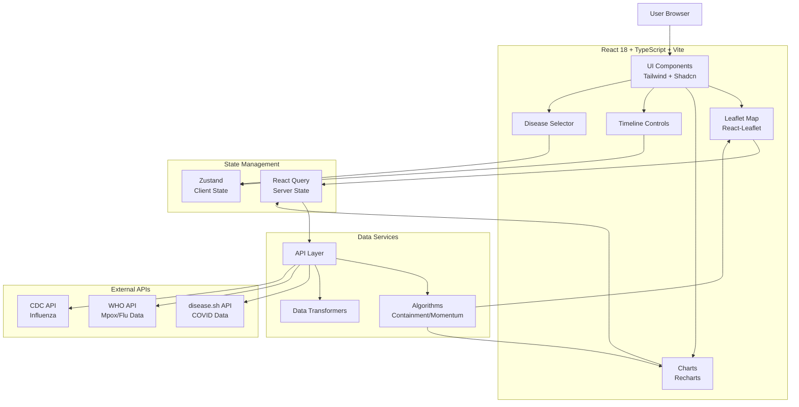
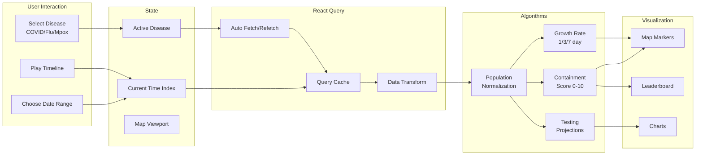

# Infectious Disease Dashboard - Modernization Plan

## Project Overview

**Original Name**: COVID-19 Dashboard  
**New Name**: Global Disease Tracker (or Infectious Disease Dashboard)  
**Vision**: Transform the 2020-era COVID-19 tracker into a modern, multi-disease surveillance platform showcasing advanced data visualization and full-stack development skills.

## Strategic Objectives

1. **Archive Historical COVID-19 Data** - Preserve 2020-2021 pandemic tracking as a historical reference
2. **Expand to Multi-Disease Platform** - Add Influenza and Mpox with extensible architecture for future diseases
3. **Modernize Tech Stack** - Migrate from React 16 + CRA to React 18 + Vite + TypeScript
4. **Enhance User Experience** - Modern UI with Tailwind CSS, dark mode, mobile-first responsive design
5. **Improve Performance** - React Query for data management, code splitting, optimized bundle size
6. **Deploy to Vercel** - Consistent hosting with other portfolio projects

---

## Current State Analysis

### Tech Stack (Outdated - 2020)
```json
{
  "react": "^16.13.0",           // 5 years old
  "react-scripts": "3.4.0",      // CRA deprecated
  "@material-ui/core": "^4.9.5", // MUI v4 superseded
  "react-bootstrap": "^1.0.0-beta.17",
  "leaflet": "^1.6.0",           // Current is 1.9+
  "papaparse": "^5.1.1"
}
```

### Data Sources (Broken)
- ❌ Johns Hopkins CSSE GitHub CSV files (recovery endpoint returns 404)
- ❌ Last updated: August 2021 (tracking discontinued)
- ⚠️ 8 different CSV endpoints, 6 still functional but outdated

### Core Features to Preserve
✅ **Interactive Leaflet Map** - Country selection with color-coded visualization  
✅ **Timeline Controls** - Play/pause/stop time replay  
✅ **Visualization Modes** - Cumulative, momentum (1/3/7-day growth rates)  
✅ **Containment Score Algorithm** (lines 309-349 in [`JHDatasourceProvider.js`](coronavirus19stats/src/datasource/JHDatasourceProvider.js:309))  
✅ **Population Normalization** - Cases per million people  
✅ **Testing Rate Projections** - "What if?" scenario modeling  
✅ **Sortable Leaderboard** - Multi-column sorting with color-coded metrics  
✅ **Map Style Switching** - Light/Color/Dark themes  
✅ **Logarithmic Scaling** - Linear and log scale options  

---

## New Architecture

### Modern Tech Stack

```typescript
{
  "framework": "React 18.3+",
  "buildTool": "Vite 5+",
  "language": "TypeScript 5+",
  "styling": "Tailwind CSS 3.4+ + Shadcn/ui",
  "stateManagement": "Zustand (client) + React Query (server)",
  "maps": "React-Leaflet 4+ with Leaflet 1.9+",
  "charts": "Recharts or Chart.js",
  "animations": "Framer Motion",
  "forms": "React Hook Form + Zod",
  "dateHandling": "date-fns",
  "testing": "Vitest + React Testing Library"
}
```

### Data Sources Strategy

#### Primary API: disease.sh
```
Base URL: https://disease.sh/v3/covid-19

Endpoints:
- /all - Global summary
- /countries - All countries data
- /countries/{country} - Specific country
- /historical - Historical time-series data
- /historical/{country} - Country historical data
- /historical/all?lastdays=all - Full COVID history
```

#### Secondary: WHO Data (if needed)
```
WHO COVID-19 API: https://covid19.who.int/
Fallback for additional disease data
```

#### Future Extensions
- CDC FluView API for Influenza data
- WHO Mpox data feeds
- Extensible provider pattern for adding new diseases

### Project Structure

```
global-disease-tracker/
├── src/
│   ├── components/
│   │   ├── ui/              # Shadcn/ui components
│   │   ├── Map/
│   │   │   ├── DiseaseMap.tsx
│   │   │   ├── MapControls.tsx
│   │   │   ├── MapMarkers.tsx
│   │   │   └── MapTooltip.tsx
│   │   ├── Timeline/
│   │   │   ├── TimelinePlayer.tsx
│   │   │   └── DateRangeSelector.tsx
│   │   ├── Leaderboard/
│   │   │   ├── DataTable.tsx
│   │   │   └── SortableColumns.tsx
│   │   ├── DiseaseSelector/
│   │   │   └── DiseaseToggle.tsx
│   │   ├── Visualizations/
│   │   │   ├── MomentumChart.tsx
│   │   │   ├── ContainmentScore.tsx
│   │   │   └── TestingProjections.tsx
│   │   └── Layout/
│   │       ├── Header.tsx
│   │       ├── Sidebar.tsx
│   │       └── Footer.tsx
│   ├── features/
│   │   ├── covid/           # COVID-19 historical archive
│   │   ├── influenza/       # Flu tracking
│   │   └── mpox/            # Mpox tracking
│   ├── services/
│   │   ├── api/
│   │   │   ├── diseaseApi.ts
│   │   │   ├── covidApi.ts
│   │   │   ├── fluApi.ts
│   │   │   └── mpoxApi.ts
│   │   └── algorithms/
│   │       ├── containmentScore.ts
│   │       ├── momentumCalculations.ts
│   │       ├── populationNormalization.ts
│   │       └── projections.ts
│   ├── hooks/
│   │   ├── useDisease Data.ts
│   │   ├── useMapControls.ts
│   │   └── useTimeline.ts
│   ├── stores/
│   │   ├── diseaseStore.ts
│   │   └── uiStore.ts
│   ├── types/
│   │   ├── disease.types.ts
│   │   ├── map.types.ts
│   │   └── api.types.ts
│   ├── utils/
│   │   ├── dataTransformers.ts
│   │   └── formatters.ts
│   ├── lib/
│   │   └── constants.ts
│   ├── App.tsx
│   └── main.tsx
├── public/
├── archive/                  # Original COVID-19 code preserved
│   └── original-src/
├── vite.config.ts
├── tailwind.config.ts
├── tsconfig.json
└── package.json
```

---

## System Architecture



---

## Data Flow Architecture



---

## Key Features

### 1. Disease Archive System
- **COVID-19 Historical Mode** (2020-2021 data preserved)
- Toggle between "Historical Archive" and "Current Tracking"
- Original data from Johns Hopkins CSSE (local backup)
- Informational banner: "Historical data - tracking ended Aug 2021"

### 2. Multi-Disease Support
- **COVID-19** - Historical archive + current data (disease.sh)
- **Influenza** - Seasonal flu tracking (CDC FluView)
- **Mpox** - Current outbreak tracking (WHO)
- Extensible architecture for future diseases

### 3. Enhanced Map Visualization
- Leaflet 1.9+ with modern tile providers
- Color-coded markers by severity/containment score
- Cluster markers for high-density areas
- Smooth animations between time periods
- Multiple overlay layers per disease

### 4. Advanced Analytics
- **Containment Score** - Preserved algorithm (0-10 scale)
- **Momentum Analysis** - 1/3/7-day growth rates
- **Testing Projections** - "What if?" scenario modeling
- **Population Normalization** - Per million calculations
- **Comparative Analysis** - Multi-disease comparison

### 5. Modern UX Features
- **Dark Mode** - System preference detection + manual toggle
- **Responsive Design** - Mobile-first approach
- **Loading States** - Skeleton screens, progress indicators
- **Error Boundaries** - Graceful error handling
- **Accessibility** - WCAG 2.1 AA compliance
- **Performance** - Code splitting, lazy loading

### 6. Data Export
- CSV export for current view
- JSON API response export
- Screenshot capture functionality
- Shareable URL with state parameters

---

## Migration Strategy

### Phase 1: Setup & Architecture (4-6 hours)

1. **Project Initialization**
   - Create new `global-disease-tracker` directory
   - Initialize Vite + React + TypeScript
   - Configure Tailwind CSS + Shadcn/ui
   - Set up ESLint, Prettier, Vitest

2. **Archive Original Code**
   - Move current `src/` to `archive/original-src/`
   - Document original features and algorithms
   - Create migration checklist

3. **Type Definitions**
   - Define core TypeScript interfaces
   - Disease data types
   - API response types
   - Map and visualization types

4. **API Layer Foundation**
   - Create API client with axios/fetch
   - Set up React Query configuration
   - Implement disease.sh endpoints
   - Error handling and retry logic

### Phase 2: Core Features (8-10 hours)

5. **Map Component Migration**
   - Install react-leaflet 4.x
   - Create [`DiseaseMap.tsx`](src/components/Map/DiseaseMap.tsx) with TypeScript
   - Migrate marker rendering logic
   - Implement color-coding system
   - Add tooltip component

6. **Algorithm Preservation**
   - Extract containment score algorithm to [`containmentScore.ts`](src/services/algorithms/containmentScore.ts)
   - Extract momentum calculations to [`momentumCalculations.ts`](src/services/algorithms/momentumCalculations.ts)
   - Port population normalization
   - Add TypeScript types and tests

7. **Timeline Controls**
   - Build [`TimelinePlayer.tsx`](src/components/Timeline/TimelinePlayer.tsx)
   - Play/pause/stop functionality
   - Date range selector
   - Speed controls (1x, 2x, 5x)

8. **Leaderboard Table**
   - Create sortable data table with Shadcn
   - Multi-column sorting
   - Color-coded cells
   - Pagination for large datasets

9. **Disease Selector UI**
   - Toggle between COVID/Flu/Mpox
   - Historical vs Current mode
   - Visual indicators for active disease

### Phase 3: Disease Integration (6-8 hours)

10. **COVID-19 Module**
    - Historical data (local JSON backup from Johns Hopkins)
    - Current data from disease.sh
    - Mode toggle (Historical Archive | Current)
    - Migration from CSV parsing to JSON

11. **Influenza Module**
    - Research CDC FluView API
    - Implement data fetching
    - Create flu-specific visualizations
    - Seasonal trend indicators

12. **Mpox Module**
    - Research WHO Mpox data sources
    - Implement data fetching
    - Create outbreak-specific features
    - Case clustering visualization

### Phase 4: UI/UX Polish (4-6 hours)

13. **Tailwind Design System**
    - Define color palette (disease-specific colors)
    - Typography system
    - Spacing and layout utilities
    - Dark mode color schemes

14. **Shadcn/ui Components**
    - Button, Card, Dialog, Dropdown
    - Select, Tabs, Toggle, Tooltip
    - Consistent component library

15. **Responsive Design**
    - Mobile navigation drawer
    - Responsive map controls
    - Touch-friendly timeline
    - Collapsible leaderboard

16. **Dark Mode**
    - System preference detection
    - Manual toggle switch
    - Persistent user preference
    - Map tile switching (dark tiles)

17. **Animations**
    - Framer Motion page transitions
    - Marker animations
    - Chart transitions
    - Loading skeletons

### Phase 5: Testing & Documentation (3-4 hours)

18. **Unit Tests**
    - Algorithm tests (containment, momentum)
    - Data transformation tests
    - Utility function tests
    - 80%+ code coverage

19. **Integration Tests**
    - API integration tests
    - Component integration tests
    - User flow tests

20. **Documentation**
    - README with setup instructions
    - API documentation
    - Algorithm explanations
    - Deployment guide
    - User guide

### Phase 6: Deployment (2-3 hours)

21. **Vercel Setup**
    - Create Vercel project
    - Configure build settings
    - Environment variables (if needed)
    - Custom domain (optional)

22. **Performance Optimization**
    - Bundle analysis
    - Code splitting
    - Image optimization
    - Lazy loading

23. **SEO & Analytics**
    - Meta tags
    - Open Graph images
    - Sitemap
    - Analytics integration (Plausible)

24. **Final Testing**
    - Cross-browser testing
    - Mobile device testing
    - Performance audits
    - Accessibility audit

---

## API Endpoints

### disease.sh API

```typescript
// COVID-19 Data
GET https://disease.sh/v3/covid-19/all
GET https://disease.sh/v3/covid-19/countries
GET https://disease.sh/v3/covid-19/countries/{country}
GET https://disease.sh/v3/covid-19/historical/all?lastdays=all
GET https://disease.sh/v3/covid-19/historical/{country}?lastdays=all

// Response Example
{
  "country": "USA",
  "cases": 103436829,
  "todayCases": 0,
  "deaths": 1127152,
  "todayDeaths": 0,
  "recovered": 101297275,
  "active": 1012402,
  "critical": 1571,
  "casesPerOneMillion": 309598,
  "deathsPerOneMillion": 3374,
  "tests": 1170271550,
  "testsPerOneMillion": 3503502,
  "population": 334085202,
  "continent": "North America",
  "updated": 1698777061000
}

// Historical Time Series
{
  "country": "USA",
  "province": null,
  "timeline": {
    "cases": {
      "1/22/20": 1,
      "1/23/20": 1,
      "1/24/20": 2,
      // ... all dates
    },
    "deaths": { /* ... */ },
    "recovered": { /* ... */ }
  }
}
```

### WHO APIs (TBD - Requires Research)
- Mpox outbreak data
- Influenza surveillance data
- Global health statistics

### CDC FluView (TBD - Requires Research)
- Seasonal flu activity
- ILI (Influenza-like illness) percentages
- Hospitalization rates

---

## Preserved Algorithms

### Containment Score (0-10 Scale)

Original algorithm from [`JHDatasourceProvider.js:309-349`](coronavirus19stats/src/datasource/JHDatasourceProvider.js:309):

```typescript
/**
 * Calculates containment score on 0-10 scale
 * Weighted average of:
 * - Testing rate (tests per confirmed case)
 * - Recovery rate (recovered / confirmed)
 * - Mortality rate (deaths / confirmed)
 * - Growth momentum (7-day trend)
 */
function calculateContainmentScore(data: CountryData): number {
  const testingWeight = 0.3;
  const recoveryWeight = 0.3;
  const mortalityWeight = 0.2;
  const momentumWeight = 0.2;
  
  // Testing score: Higher tests per case = better containment
  const testsPerCase = data.tests / data.cases;
  const testingScore = Math.min(testsPerCase / 10, 1) * 10;
  
  // Recovery score: Higher recovery rate = better
  const recoveryRate = data.recovered / data.cases;
  const recoveryScore = recoveryRate * 10;
  
  // Mortality score: Lower mortality = better (inverted)
  const mortalityRate = data.deaths / data.cases;
  const mortalityScore = (1 - mortalityRate) * 10;
  
  // Momentum score: Decreasing cases = better
  const momentum7Day = calculate7DayGrowth(data.timeline);
  const momentumScore = momentum7Day < 0 ? 10 : Math.max(10 - momentum7Day, 0);
  
  const score = 
    testingScore * testingWeight +
    recoveryScore * recoveryWeight +
    mortalityScore * mortalityWeight +
    momentumScore * momentumWeight;
    
  return Math.round(score * 10) / 10; // One decimal place
}
```

### Momentum Calculations

```typescript
/**
 * Calculate growth rates over different periods
 */
function calculateMomentum(timeline: TimeSeries) {
  const latest = timeline[timeline.length - 1];
  const yesterday = timeline[timeline.length - 2];
  const threeDaysAgo = timeline[timeline.length - 4];
  const sevenDaysAgo = timeline[timeline.length - 8];
  
  return {
    daily: ((latest - yesterday) / yesterday) * 100,
    threeDayAvg: ((latest - threeDaysAgo) / threeDaysAgo / 3) * 100,
    sevenDayAvg: ((latest - sevenDaysAgo) / sevenDaysAgo / 7) * 100
  };
}
```

### Population Normalization

```typescript
/**
 * Normalize counts per million population
 */
function normalizePerMillion(count: number, population: number): number {
  return (count / population) * 1_000_000;
}
```

---

## Timeline & Estimates

| Phase | Tasks | Duration | Dependencies |
|-------|-------|----------|--------------|
| **1. Setup** | 1-4 | 4-6 hours | None |
| **2. Core** | 5-9 | 8-10 hours | Phase 1 complete |
| **3. Diseases** | 10-12 | 6-8 hours | Phase 2 complete |
| **4. UI/UX** | 13-17 | 4-6 hours | Phase 2 complete |
| **5. Testing** | 18-20 | 3-4 hours | Phases 2-4 complete |
| **6. Deploy** | 21-24 | 2-3 hours | All phases complete |
| **TOTAL** | 24 tasks | **27-37 hours** | Sequential |

**Recommended Approach**: 
- Week 1: Phases 1-2 (Foundation + Core)
- Week 2: Phases 3-4 (Diseases + UI)
- Week 3: Phases 5-6 (Testing + Deploy)

---

## Success Criteria

### Technical
- ✅ Modern tech stack (React 18, Vite, TypeScript, Tailwind)
- ✅ All core algorithms preserved and working
- ✅ 3 diseases supported (COVID archive, Flu, Mpox)
- ✅ Mobile-responsive design
- ✅ Dark mode implemented
- ✅ 80%+ test coverage
- ✅ Lighthouse score: 90+ (Performance, Accessibility, Best Practices, SEO)
- ✅ Bundle size < 500KB (gzipped)

### Functional
- ✅ Interactive map with disease-specific markers
- ✅ Timeline playback controls
- ✅ Sortable leaderboard with real-time data
- ✅ Disease selector toggle
- ✅ Historical vs current mode for COVID
- ✅ Data export functionality
- ✅ Shareable URLs

### Portfolio Impact
- ✅ Demonstrates full-stack modernization skills
- ✅ Shows algorithm preservation and refactoring
- ✅ Highlights TypeScript proficiency
- ✅ Proves responsive design capabilities
- ✅ Exhibits API integration expertise
- ✅ Live demo deployed on Vercel

---

## Risks & Mitigation

| Risk | Impact | Probability | Mitigation |
|------|--------|-------------|------------|
| API rate limits (disease.sh) | High | Medium | Implement caching, use React Query stale time |
| Missing flu/mpox APIs | Medium | Medium | Start with COVID only, add diseases incrementally |
| Algorithm complexity | Medium | Low | Unit test thoroughly, compare with original outputs |
| Historical data size | Low | Low | Lazy load, paginate, use virtual scrolling |
| Mobile performance | Medium | Medium | Code splitting, optimize bundle, lazy load maps |

---

## Post-Launch Enhancements

### Phase 7: Advanced Features (Future)
- Multi-disease comparison charts
- Prediction models using ML (TensorFlow.js)
- Social media integration for outbreak alerts
- Email alerts for high-risk areas
- PWA capabilities (offline mode)
- Real-time WebSocket updates
- Admin dashboard for data curation

---

## Migration Checklist

### Pre-Migration
- [ ] Backup entire coronavirus19stats directory
- [ ] Document all current features with screenshots
- [ ] Export current Firebase deployment settings
- [ ] Create comprehensive test dataset

### During Migration
- [ ] Archive original code to `archive/`
- [ ] Set up new project structure
- [ ] Migrate algorithms with tests
- [ ] Port features incrementally
- [ ] Maintain feature parity checklist

### Post-Migration
- [ ] Side-by-side comparison (old vs new)
- [ ] Performance benchmarking
- [ ] User acceptance testing
- [ ] Update portfolio documentation
- [ ] Redirect Firebase domain to Vercel (or update DNS)

---

## Resources & References

### Documentation
- [disease.sh API Docs](https://disease.sh/docs/)
- [React 18 Migration Guide](https://react.dev/blog/2022/03/08/react-18-upgrade-guide)
- [Vite Documentation](https://vitejs.dev/)
- [Tailwind CSS](https://tailwindcss.com/)
- [Shadcn/ui Components](https://ui.shadcn.com/)
- [React Leaflet](https://react-leaflet.js.org/)

### APIs to Research
- WHO COVID-19 API
- CDC FluView API
- WHO Mpox Outbreak Data
- Our World in Data

### Tools
- Vite Plugin PWA
- React Query DevTools
- Bundle analyzer
- Lighthouse CI

---

## Appendix: Original Features Audit

### Features to Preserve ✅
- [x] Interactive Leaflet map
- [x] Country selection
- [x] Timeline controls (play/pause/stop)
- [x] Momentum visualization (1/3/7-day)
- [x] Containment score (0-10)
- [x] Testing rate projections
- [x] Population normalization
- [x] Sortable leaderboard
- [x] Map style switching
- [x] Logarithmic scaling

### Features to Modernize 🔄
- [ ] CSV parsing → JSON API
- [ ] Material-UI → Tailwind + Shadcn
- [ ] Inline styles → Tailwind classes
- [ ] Class components → Function components + hooks
- [ ] Manual state → React Query + Zustand
- [ ] Prop drilling → Context/Zustand

### Features to Remove ❌
- [ ] Recovery data (no longer available)
- [ ] Wikipedia scraping (replace with API)
- [ ] Bootstrap dependencies
- [ ] jQuery (not used but in deps)

---

**Document Version**: 1.0  
**Last Updated**: 2025-10-31  
**Status**: Planning Phase  
**Next Review**: After Phase 1 completion